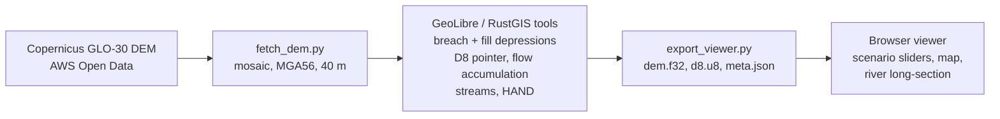

# Flood Explorer

A screening tool for river and coastal flooding anywhere in Australia. Pick a river town or coast, or tap any gauge, dam or spot on the map; set a river level, a bay level and a sea-level-rise allowance, and the map shows which land sits below the water surface and connects to the river, with depths. A detailed model of the lower Brisbane River, with its historic flood peaks and council flood maps, is included.

For the processed Brisbane area the flood layer sits on a pan-and-zoom street map: tap anywhere for ground level and water depth, tap the river to move the gauge, or jump to your location. It opens on Esri satellite imagery; switch between satellite, street, Queensland Government aerial and topographic, and other basemaps with the layer button. Satellite layers from Digital Earth Australia work anywhere in Australia: the latest Landsat/Sentinel-2 imagery in true colour or false-colour infrared, where water stands out dark against vegetation, and a map of how often satellites have seen water at each spot since 1987. Brisbane City Council's creek and overland-flow flood likelihood maps and the recorded 1974, 2011 and 2022 flood extents can be switched on from the same button, to compare the model with the council's studies and with what actually happened.

The heavy terrain work is done by the hydrology tools that power [RustGIS](https://github.com/opengeos/RustGIS) (the [GeoLibre](https://github.com/opengeos/geolibre-rust) runner, built on Whitebox). A small browser viewer then runs the flood scenarios instantly.

**Live site:** https://ghedwards.github.io/brisbane-flood-explorer/ (after GitHub Pages is switched on, see [Setup](#setup)).

> **Not for emergency or property decisions.** This is a screening model built on a 30 m surface model. Use [Brisbane City Council Flood Awareness Maps](https://fam.brisbane.qld.gov.au/) and [Bureau of Meteorology warnings](https://www.bom.gov.au/qld/warnings/) for real flood risk.

## Australia-wide view

The menu at the top has one-tap presets for about 60 well-known flood sites and populated flood-prone places, grouped by state: river towns such as Lismore, Maitland, Windsor, Wagga Wagga, Forbes, Rockhampton, Bundaberg, Ipswich, Townsville, Charleville, Rochester, Shepparton, Echuca, Murray Bridge, Carnarvon, Fitzroy Crossing, Launceston and Katherine, plus coasts and estuaries from Cairns to Hobart. Picking one models it on the spot over a 20 km square; when the flood reaches the edge of that square the Scenario panel says so and offers *Extend model area*, which rebuilds it 40 km and then 80 km across, shifted toward the edges the water reaches; places you've modelled are listed at the top of the menu, and the detailed Brisbane River model is under *Detailed models*.


The app opens on a map of Australia:

- **Bureau of Meteorology flood forecast gauges, tide gauges and dams**, with flood information and other river gauges appearing as you zoom in. Dams are coloured by how full they are.
- **Tap any of them for a report:** location, basin or river, operator, the latest daily reading from Water Data Online with a 10-day trend, percentage full for dams, and Google Flood Hub's forecast for a nearby gauge when that feed is connected.
- **Model flooding here:** from a report, or by tapping anywhere on the map. The app downloads Geoscience Australia's 1-second (about 30 m) hydrologically enforced elevation model (DEM-H) for a 20 km square around the point. It works out how water flows across it in the browser, then runs the same flood model used for Brisbane. River models start with the water 3 m above the river surface at that point. Coastal models start with the bay at 1.5 m, and sea-level rise can be added. Heights are metres above sea level, not the gauge's own datum.
- **State flood mapping** in the Layers panel: Queensland's statewide Floodplain Assessment Overlay, and NSW flood planning areas from council planning schemes (visible when zoomed in). Victoria's statewide 1% flood extent is not openly published as a web service, so it isn't included yet. Reports for Queensland and NSW gauges and dams have a button to switch on that state's layer.
- **Layers at every zoom:** where a data server only draws a layer when zoomed in, the app either fetches tiles at the zoom the server allows and scales them to fit (DEA satellite basemaps, down to state-wide view), or the build stitches an Australia-wide or city-wide image once a month that is shown when zoomed out (DEA water history: [`pipeline/render_dea_mosaic.py`](pipeline/render_dea_mosaic.py); Brisbane council likelihood layers: [`pipeline/render_council_layers.py`](pipeline/render_council_layers.py)). NSW's flood planning layer has its server-side scale limit lifted.
- **Dam reports** also show how much of the dam's surface satellites have seen wet on each clear Landsat pass since 1987, from Digital Earth Australia Waterbodies.
- **Places: several areas and reports at once.** Reports and modelled areas share one set of numbers: an area modelled from report 2 is also 2, and an area modelled by tapping the map takes the next free number. **Places** sits at the top of the left column, always visible and collapsible, with the flood Scenario beneath it, also always shown and collapsible. The Scenario follows the selected place: its flood scenario if it has been modelled, otherwise buttons to model river or coastal flooding there; reports open on the right, one at a time (‹ › to step through them), so a scenario and a report can be read side by side. Choosing a row works exactly like tapping that number on the map: its flood scenario becomes active and its report shows. Small icons on each row open its report (or the nearest gauge's), zoom to it, or remove it; Tapping a gauge or dam shows a small popup (name, latest reading) with one button to add it as a place and open its report; tapping an empty spot shows its coordinates and the nearest gauge, with the same button to add it as a place: a numbered pin you can model or report on the nearest gauge. The ‹ › buttons in the Scenario and Report panels step through modelled places and reports, selecting each so the map, Places and the other panel follow. Each modelled area keeps its own scenario (up to six), one is active at a time, and up to eight reports stay open.
- **Lower Brisbane River** remains available from the menu as the detailed, pre-processed model with historic flood peaks and council layers.

The build fetches the Bureau's gauges, dams and readings every three hours ([`pipeline/fetch_national.py`](pipeline/fetch_national.py)), and each dam's satellite water history once a week ([`pipeline/fetch_waterhistory.py`](pipeline/fetch_waterhistory.py)), because those services don't allow requests straight from a web page. Geoscience Australia's elevation service and Digital Earth Australia's layers do, so the page reads those directly.

## How it works



GitHub Actions runs the whole pipeline on every push to `main`, publishes the viewer and data to GitHub Pages, then loads the live site in a headless browser to check the interactive map works ([`.github/workflows/build.yml`](.github/workflows/build.yml), [`tests/smoke_live.py`](tests/smoke_live.py)). The check's results appear as annotations on the workflow run, with a screenshot attached.

### 1. Terrain (`pipeline/fetch_dem.py`)

Downloads the Copernicus GLO-30 tiles covering the area in [`config/brisbane.json`](config/brisbane.json), mosaics them, and reprojects to GDA2020 / MGA zone 56 at 40 m. No login is needed.

### 2. Hydrology with the RustGIS tools (`pipeline/run_hydrology.sh`)

`pipeline/install_geolibre.sh` installs the same `geolibre` runner that RustGIS downloads for its Analyze > GeoLibre toolboxes (pinned release, SHA-256 checked). The pipeline then runs:

| Step | Tool | Output |
|---|---|---|
| Carve through embankments and bridges | `breach_depressions_least_cost` | `dem_breached.tif` |
| Make flats drain | `fill_depressions --fix_flats=true` | `dem_cond.tif` |
| Flow directions | `d8_pointer` | `d8.tif` |
| Flow accumulation | `d8_flow_accum` | `acc.tif` |
| Stream network | `extract_streams` | `streams.tif` |
| Height above nearest drainage | `elevation_above_stream` | `hand.tif` |

Every step is also available in the RustGIS desktop or web app, so you can open `dem.tif` there and repeat or inspect any stage by hand. The published site links the HAND, streams and flow-direction GeoTIFFs for download.

### 3. Flood scenarios (in the browser)

[`viewer/flood-core.js`](viewer/flood-core.js) takes the ground elevations and the D8 flow directions and:

1. Builds the stream network from a minimum catchment area.
2. Sets a water surface along the river: it varies linearly with river distance from the bay level at the mouth to the chosen level at the gauge, and rises at a set slope (default 0.3 m/km) upstream of the gauge and up tributaries.
3. Gives every cell the water level of the stream it drains to. This generalises HAND, which assumes one flood stage everywhere.
4. Floods a cell when its ground is below that level **and** it touches water through neighbouring wet cells, so low ground behind high ground stays dry.
5. Reports land newly flooded compared with normal conditions (gauge 0.5 m, bay at 0 m).

Sea-level rise raises the bay level, which lifts the lower reaches through step 2.

### Scenarios included

Peaks at the Brisbane City gauge from the Bureau of Meteorology's [lower Brisbane River flood warning brochure](https://www.bom.gov.au/qld/flood/brochures/brisbane_lower/brisbane_lower.shtml):

| Flood | Peak (m) |
|---|---|
| Feb 1893 | 8.35 |
| Jan 1974 | 5.45 |
| Jan 2011 | 4.46 |
| Feb 2022 | 3.85 |
| Jan 2013 | 2.30 |

Sea-level rise options run from 0.3 m to 1.1 m, including Queensland's 0.8 m planning allowance to 2100. The "extra river peak" slider is a manual allowance for heavier rainfall; the model does not turn rainfall into river levels.

## Live forecasts from Google Flood Hub

The site can show Google's [Flood Forecasting API](https://developers.google.com/flood-forecasting) data for South East Queensland: forecast flood severity at river gauges (with trend, forecast peak and warning thresholds), Google's forecast flood areas, and flash flood forecasts. The same forecasts appear on [Flood Hub](https://sites.research.google/floods/). The data is free and CC BY 4.0.

The build fetches the forecasts every three hours ([`pipeline/fetch_floodhub.py`](pipeline/fetch_floodhub.py)) and publishes them with the site, so the API key is never exposed in the page. They show in a "Google Flood Hub forecast" panel and as two map layers, which switch on automatically when anything is forecast above normal.

**To switch it on:**

1. Join the API waitlist from the [Flood Forecasting API page](https://developers.google.com/flood-forecasting), signed in with the Google account you'll use.
2. When Google approves you, reply to their email with your Google Cloud project number.
3. In that Google Cloud project, enable the **Flood Forecasting API** and create an **API key**. Restrict the key to the Flood Forecasting API.
4. In this GitHub repository, open Settings > Secrets and variables > Actions and add a repository secret named `FLOOD_FORECASTING_API_KEY` with the key.
5. Run the workflow from the Actions tab, or wait for the next three-hourly run.

Until then the panel says the feed isn't connected. Google's forecasts are experimental and are not official warnings; the Bureau of Meteorology remains the authority in Australia.

## Limitations

- **Surface model, not bare earth.** GLO-30 includes buildings and trees, which wrongly raise ground levels in suburbs and along vegetated banks. A LiDAR DEM from [ELVIS](https://elevation.fsdf.org.au/) fixes most of this.
- **Static water surface.** No flood wave, timing, velocity, storage or flow through bridges and culverts. The linear water surface between gauge and mouth is a simplification; real flood profiles bend.
- **Only river and sea flooding.** Rainfall on the floodplain, creeks rising on their own, stormwater backflow and overland flow are not modelled. In 2022 much of Brisbane's damage came from creek and flash flooding that this model cannot show.
- **Datum.** GLO-30 heights use the EGM2008 geoid, a few tenths of a metre from AHD around Brisbane; gauge levels are treated as AHD.
- **Levees and flood gates** are not represented unless they appear in the terrain.

For full hydrodynamic modelling, the outputs here are a starting point for [ANUGA](https://github.com/GeoscienceAustralia/anuga_core) or [LISFLOOD-FP](https://www.seamlesswave.com/LISFLOOD8.0).

## Setup

1. **Turn on GitHub Pages.** In the repository, open Settings > Pages and set Source to **GitHub Actions**.
2. **Run the workflow.** Push to `main` or use Actions > *Build terrain and publish viewer* > Run workflow. The build summary says whether the DEM download and the hydrology step succeeded. If either fails, the site still publishes; the Australia-wide map and on-demand models don't depend on it.

## Run it yourself

The viewer is plain HTML and JavaScript with no build step:

```sh
python3 -m http.server -d viewer 8000   # then open http://localhost:8000
```

If the map library can't load (offline), it falls back to an illustrative sample terrain, which isn't otherwise in the menu. You can also load your own GeoTIFF or ASCII grid DEM in the page, optionally with a `d8.tif` from the pipeline.

To run the pipeline locally (Linux or macOS, needs Python 3.10+ and the GitHub CLI):

```sh
pip install -r pipeline/requirements.txt
pipeline/install_geolibre.sh ~/.local/bin
python pipeline/fetch_dem.py config/brisbane.json work/brisbane
pipeline/run_hydrology.sh config/brisbane.json work/brisbane
python pipeline/export_viewer.py config/brisbane.json work/brisbane viewer/data
python3 -m http.server -d viewer 8000
```

**Using LiDAR instead of GLO-30:** download a DEM for your area from ELVIS, reproject it to the area's CRS (EPSG:7856 for Brisbane), save it as `work/brisbane/dem.tif`, and start from the hydrology step. Set `cell_m` in the config to the LiDAR cell size, since the stream threshold depends on it. At 1–5 m the grid gets large, so clip to the reach you care about.

**Another river:** copy `config/brisbane.json`, change the bounding box, CRS, gauge and `brisbane_gauge_events: false`, and add the area to the workflow.

## Tests

```sh
node --test tests/core.test.js
python -m unittest tests/test_floodhub.py tests/test_national.py   # data fetchers, with the services mocked
```

The tests check routing (every cell drains), monotonic flooding, water levels at the gauge and mouth, connectivity, and that Whitebox D8 pointers from the pipeline reproduce the browser's own routing exactly.

## Repository layout

```
config/brisbane.json         area, CRS, cell size, gauge, thresholds
pipeline/                    DEM download, GeoLibre install + hydrology, export
viewer/                      static web app (index.html, app.js, flood-core.js)
tests/                       Node tests for the flood model
.github/workflows/build.yml  CI: test, build terrain, publish to Pages
```

## Data and credits

- Terrain: Copernicus GLO-30 Digital Elevation Model, © DLR e.V. 2010–2014 and © Airbus Defence and Space GmbH 2014–2018, provided under COPERNICUS by the European Union and ESA; all rights reserved. Accessed through the [AWS Open Data registry](https://registry.opendata.aws/copernicus-dem/).
- Hydrology tools: [GeoLibre](https://github.com/opengeos/geolibre-rust) and [Whitebox](https://github.com/opengeos/whitebox-wasm), as used by [RustGIS](https://github.com/opengeos/RustGIS).
- Flood peaks: Bureau of Meteorology.
- National gauges, dams and readings: © Commonwealth of Australia (Bureau of Meteorology): the [National Flood Gauge Network](https://data.gov.au/data/dataset/national-flood-gauge-network) (CC BY 4.0), Australian water storages, and [Water Data Online](http://www.bom.gov.au/waterdata/) (CC BY; some data owners set their own terms).
- State flood layers: [Queensland Floodplain Assessment Overlay](https://www.qld.gov.au/emergency/dealing-disasters/disaster-types/flood/for-councils-and-flood-practitioners/flood-data-and-resources/queensland-floodplain-assessment-overlay) (© State of Queensland, CC BY 4.0) and NSW flood planning areas (NSW Department of Planning, from local environmental plans), drawn by each state's map server.
- Dam water history: [DEA Waterbodies](https://knowledge.dea.ga.gov.au/data/product/dea-waterbodies-landsat/) (Geoscience Australia), CC BY 4.0.
- On-demand terrain: [Geoscience Australia DEM-H](https://data.gov.au/data/dataset/66c4df82-b8bb-48b9-9649-3ac082625c9f), 1-second SRTM-derived hydrologically enforced DEM, CC BY 4.0.
- Live forecasts: [Google Flood Hub](https://sites.research.google/floods/) via the Flood Forecasting API, CC BY 4.0.
- Creek and overland flow likelihood and recorded flood extents: [Brisbane City Council Flood Awareness data](https://data.brisbane.qld.gov.au/), CC BY 4.0, read live from the council's ArcGIS services with [esri-leaflet](https://github.com/Esri/esri-leaflet).
- GeoTIFF reading in the browser: [geotiff.js](https://github.com/geotiffjs/geotiff.js).
- Street map: [Leaflet](https://leafletjs.com/). Basemaps, chosen with the layer button on the map:
  - Streets: © [OpenStreetMap](https://www.openstreetmap.org/copyright) contributors © [CARTO](https://carto.com/attributions)
  - OpenStreetMap standard tiles, used under the [OSM tile usage policy](https://operations.osmfoundation.org/policies/tiles/)
  - Satellite: Esri World Imagery (Esri, Maxar, Earthstar Geographics). Check [Esri's terms](https://www.esri.com/en-us/legal/terms/full-master-agreement) before any commercial use.
  - Queensland aerial imagery and topographic basemaps: © State of Queensland (Department of Natural Resources and Mines, Manufacturing and Regional and Rural Development), [CC BY 4.0](https://creativecommons.org/licenses/by/4.0/); imagery partly © Planet Labs Netherlands B.V. under licence from Planet and Geoplex
  - Topographic: © [OpenTopoMap](https://opentopomap.org) (CC BY-SA), map data © OpenStreetMap contributors, SRTM
  - Latest satellite (true colour and false-colour infrared) and the "water seen by satellite since 1987" layer: [Digital Earth Australia](https://www.dea.ga.gov.au/) (Geoscience Australia; Landsat and Copernicus Sentinel-2 data), CC BY 4.0, via DEA's public map service. The infrared view shows shortwave infrared as red, near infrared as green and green as blue, so water appears dark blue or black and vegetation green.

Released under the MIT licence (see [LICENSE](LICENSE)).
